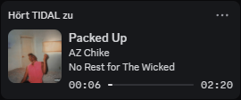

 <p align="center">
  
</p>

<h1 align="center">TidalDiscordRPC</h1>

<p align="center">
  Show your TIDAL music on Discord.
  <br>
  A lightweight Windows tray app with album artwork and playback progress.
</p>

<p align="center">
  
  
  
  
</p>

<p align="center">
  
</p>

<p align="center">
  <b>No login. No API key. Just play.</b>
</p>

---

## Features

- 🎵 **Automatic detection** — reads the current track directly from Windows media sessions.
- 🖼️ **Accurate album artwork** — matches artists and albums using the iTunes Search API.
- ⏱️ **Playback progress** — displays track start and end times in Discord.
- ⏸️ **Pause detection** — clears your Rich Presence when playback stops.
- 🖥️ **System tray integration** — control presence and Windows startup from the tray.
- 🪶 **Lightweight** — runs silently in the background with no main window.
- 🔑 **No TIDAL API access required** — no login or API key to configure.

## Quick start

1. Download `TidalDiscordRPC.exe` from the [latest release](../../releases/latest).
2. Open the Discord desktop app and TIDAL.
3. Run `TidalDiscordRPC.exe`.
4. Play a song and enjoy your Rich Presence.

> **Tip:** Enable *Start with Windows* from the tray menu to launch the app automatically.

### Tray menu

| Item | What it does |
|---|---|
| Track / artist lines | Shows the current song (play/pause symbol) |
| Presence enabled | Turns the Discord presence on or off |
| Start with Windows | Adds or removes an autostart entry (no admin rights needed) |
| Open config | Opens the optional settings file (restart the app to apply changes) |
| Open debug log | Opens the log file |
| Quit | Exits the app |

If you move the exe, toggle *Start with Windows* off and on again so the new path is stored.

### Requirements

- Windows 10 or 11
- Discord **desktop app** (the browser version does not support Rich Presence)
- TIDAL **desktop app**
- In Discord: *Settings -> Activity Privacy -> Share your detected activity* enabled, and your status not set to *Invisible*

### Windows SmartScreen / antivirus

The exe is not code-signed. Windows may show "Windows protected your PC": click **More info -> Run anyway**. Some antivirus tools also flag programs packaged with PyInstaller by mistake. If you don't trust the exe, [build it yourself](#development) from the source.

### Troubleshooting

Right-click the tray icon -> **Open debug log**. It lists the media sessions Windows sees, each track, every cover lookup, and Discord connection errors.

| Problem | Likely cause |
|---|---|
| Nothing shows up in Discord | Discord is not running (or only open in the browser), activity sharing is disabled, or the status is *Invisible* |
| Tray shows "Nothing playing" | TIDAL is not running or Windows does not see its media session |
| Wrong or missing cover | See the lookup lines in the log. The album may not exist on iTunes |
| App does not start after login | The exe was moved. Toggle *Start with Windows* off and on |

### Settings (optional)

Settings live in `%APPDATA%\TidalDiscordRPC\config.json`. The defaults work for most people.

```json
{
  "fallback_image": "tidal",
  "countries": ["de", "us"],
  "match_threshold": 0.85,
  "poll_seconds": 2
}
```

| Key | Description |
|---|---|
| `countries` | iTunes stores, tried in this order (e.g. `["us", "de"]`) |
| `match_threshold` | Minimum album similarity, `0..1`. Lower = more covers, higher risk of wrong ones |
| `poll_seconds` | How often the Windows media session is checked |
| `fallback_image` | Art asset shown when no cover is found |

Cache and logs are stored in the same folder: `covers.json` (cover cache) and `debug.log` (rotates at 512 KB, keeps one `debug.old.log`).

---

## How it works

```
Windows media session (GSMTC)  ->  track, artist, album, position
            |
            v
iTunes Search API  ->  cover URL (artist ID lookup + fuzzy album matching)
            |
            v
Discord Rich Presence (local IPC via pypresence)
```

### Cover matching

A wrong cover is worse than no cover, so a cover is only used when it passes an artist and album check. Per iTunes store (default `de`, then `us`), the app tries:

1. **Artist lookup:** find the artist ID, fetch all albums of that artist and match the album name (normalized: accents and brackets like *(Deluxe)* or *- Single* are ignored; similarity >= 0.85)
2. **Album search:** search by album name only, then filter by artist
3. **Song search:** verify title, artist and album of the result

If nothing passes, the fallback image is shown. Found covers are cached in `covers.json`. Misses and network errors are never written to disk. iTunes allows roughly 20 requests per minute, so requests are throttled; the first track of an unknown artist can take a few seconds to get its cover.

---

## Development

### Run from source

Requires Python 3.10+.

```
git clone https://github.com/LordMaddhi/TidalDiscordRPC.git
cd TidalDiscordRPC
pip install -r requirements.txt
run.bat
```

`run.bat` starts the app without a console window. To see errors directly, run `python tidal_discord_rpc.py` instead.

### Build the exe

```
build.bat
```

Creates `.venv` if it does not exist, installs the dependencies and builds `dist\TidalDiscordRPC.exe` (single file, no console, `icon.ico`). Quit the running app first, otherwise Windows blocks overwriting the exe.

### Discord application ID

The Rich Presence is sent through a Discord application whose ID is set in `tidal_discord_rpc.py`:

```python
DEFAULT_CONFIG = {
    "discord_client_id": "...",   # Application ID
    "fallback_image": "tidal",
    ...
}
```

If you **fork** this project, create your own application and replace the ID:

1. Open the [Discord Developer Portal](https://discord.com/developers/applications) and create an application. Its **name is shown after "Listening to"**.
2. Copy the **Application ID** into `DEFAULT_CONFIG`.
3. Under *Rich Presence -> Art Assets*, upload a fallback image named `tidal`.

For testing you can also override the ID in `%APPDATA%\TidalDiscordRPC\config.json` with `"discord_client_id"`; values in that file take precedence over the defaults in the code.

### Project structure

```
tidal_discord_rpc.py   main app (media watcher, cover resolver, Discord, tray)
requirements.txt       dependencies
build.bat              builds dist\TidalDiscordRPC.exe
run.bat                starts the app from source without a console
icon.ico / icon.png    app icon
```

Dependencies are kept small on purpose: `pypresence`, `pystray`, `pillow` and the `winrt-*` packages for the media session. HTTP and fuzzy matching use the standard library.

---

## Disclaimer

Not affiliated with or endorsed by TIDAL, Discord or Apple. Cover art is fetched from the public iTunes Search API and belongs to its respective owners.

## License

[MIT](LICENSE)